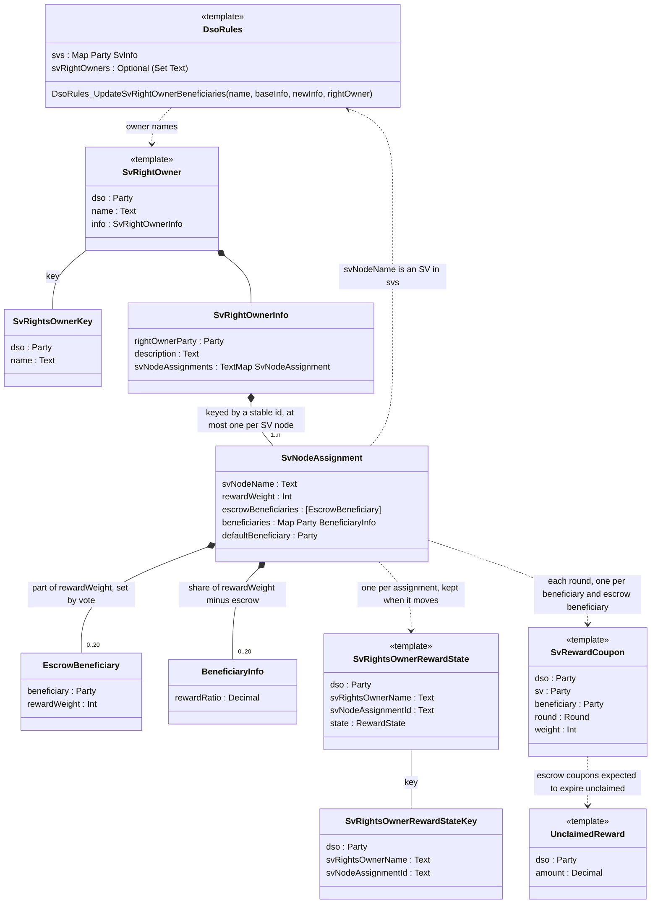

# SV rights owners PoC: types and the DevNet config converted

- One `SvRightOwner` per owner, with key `SvRightsOwnerKey` and its `SvNodeAssignment`s, keyed by a stable id unique per owner (`<owner>-<n>` by convention), at most one per SV node.
- An assignment has its SV node, its weight, escrow beneficiaries with fixed weights inside `rewardWeight` (set only by a vote), beneficiaries with a share of the non-escrowed weight, and a default beneficiary for the rest. The owner changes only the beneficiaries and the default beneficiary.
- One `SvRightsOwnerRewardState` per assignment, with key `(dso, svRightsOwnerName, svNodeAssignmentId)`. Moving an assignment to another SV node keeps it. Open: merging an assignment into another one of the same owner (retiring an SV node) can mint the open rounds of the removed one again.
- At migration each assignment gets a copy of its SV node's `SvRewardState`, and every SV node keeps its weight, so no round is minted twice or missed.
- Escrow coupons go to the escrow beneficiaries (today's ghost parties) and expire into `UnclaimedReward`, as ghost coupons do today; release stays as today (CIP-0066).
- An owner without a party of its own gets `dso` as `rightOwnerParty` and `defaultBeneficiary` until a vote sets its party.

## The DevNet config converted

[`convert.sh`](scratch/sv-rights-owners-conversion/convert.sh) converts [`approved-sv-id-values.DevNet.yaml`](scratch/sv-rights-owners-conversion/approved-sv-id-values.DevNet.yaml) (canton-foundation/configs#413, which names the owner of every entry) with [`Convert.daml`](scratch/sv-rights-owners-conversion/Convert.daml) into [`sv-right-owners.DevNet.json`](scratch/sv-rights-owners-conversion/sv-right-owners.DevNet.json), the argument of `DsoRules_MigrateToOnLedgerSvRightOwners`. It checks the result with the production Daml: every owner is valid, and per SV node the total weight and the coupons per party equal today's, escrow included. 52 owners, 56 assignments, 15 SV nodes. Remove before merging.

- Entries commented `escrow party_id …` or `… unassigned weight …` become escrow beneficiaries, unless the party also gets active weight (Talos, BitGo, Taurus: today that party claims both).
- `rightOwnerParty` is the owner's SV party, else its last active party, else `dso`. The yaml has no SV and DSO party ids, so `<name>::1220` followed by 64 zeros stands for them.
- Beneficiary ratios are rounded up, so the mint floors back to the exact weight.
